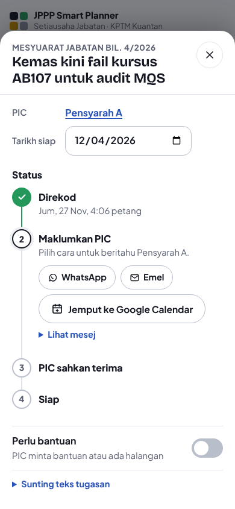
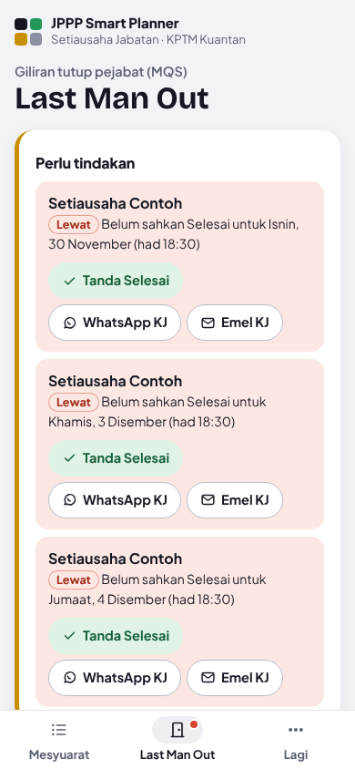

# JPPP Smart Planner

**Setiausaha Jabatan · KPTM Kuantan**

*Rekod tindakan mesyuarat, maklumkan setiap PIC dengan satu sentuhan, dan lihat sekali pandang siapa yang sudah tahu. Serta giliran Last Man Out (MQS).*
*Record meeting actions, tell each PIC in one tap, and see at a glance who knows. Plus the Last Man Out (MQS) rota.*

**Live app:** https://hafizi-ui.github.io/planner/
**Demo with example data:** https://hafizi-ui.github.io/planner/?demo=1


## The problem

After every department meeting the secretary (Setiausaha Jabatan, SU) has a list of actions, each for a lecturer (the PIC, person in charge). Her real question is simple: **does every PIC know their task yet?** WhatsApp chats and paper minutes cannot answer it, and a general to-do list does not know who was told, who replied and what is late.

## The idea

The planner serves exactly two situations:

1. **Mesyuarat (meetings).** Record each action with its PIC and due date, tell the PIC by WhatsApp or email in one tap, and follow it until it is done.
2. **Last Man Out (MQS).** Run the weekly office-closing rota, with reminders, a *Selesai* (done) confirmation and printable audit evidence.

The main screen opens with one sentence that answers the owner's question, for example **"2 PIC belum tahu tugasan mereka · 3 menunggu pengesahan · 1 lewat"**, and below it one list grouped by status.

## Meetings: from minutes to "every PIC knows"



**Tugasan baharu** (new task) asks three things, in about ten seconds:

- **Apa tugasannya?** (what): typing *esok* or *hari ini* (tomorrow, today) picks the due date for you
- **Siapa PIC?** (who): chips with your 3 most recent PICs and a search over your contacts. A name that is not a contact can still be used, and the planner offers to save it. A PIC without a WhatsApp number shows *Tiada no. WhatsApp* straight away
- **Bila perlu siap?** (when): Hari ini · Esok · Jumaat ini · Minggu depan · Pilih tarikh · Tiada tarikh

**Simpan & tambah lagi** keeps the date for the next action, made for entering ten actions after a meeting.

Every task moves through four steps, and each step has one next action:

| Group on the screen | Meaning | Your next action |
|---|---|---|
| **Belum dimaklumkan** (not told yet) | Recorded, the PIC does not know | **Hantar kepada N PIC**: one message per PIC with all their new tasks, or WhatsApp / email from the task |
| **Menunggu PIC sahkan** (waiting) | Message sent, no reply yet | Tap **Sudah tahu** when the PIC replies ("Baik, noted"). After 2 working days without a reply the task offers a ready-written reminder |
| **PIC sudah tahu** (PIC knows) | The PIC confirmed | Watch the due date; ask for status if needed |
| **Siap** (done) | Done | Nothing. Done tasks fold away and leave the list after 30 days |

**Lewat** (overdue) is a red flag on top of any step, and the late task sorts first. **Perlu bantuan** (needs help) is a switch on the task. Nothing moves by itself, and the Ketua Jabatan is never contacted about meeting tasks: only you are prompted.

**Hantar kepada PIC** (send to PICs) builds one message per person, numbered and sorted by due date, with an optional title such as *"Mesyuarat Jabatan Bil. 4/2026"*. Each card turns grey with "Dihantar melalui WhatsApp, 8:15 pagi" as you send it, so you can work down the list. Tapping a PIC's name shows all their tasks, an **Ask for status** message (they reply A = not started, B = in progress, C = done, D = need help) and **Tanda semua sudah tahu** (mark all as known).

The planner cannot send WhatsApp messages by itself (that needs the paid WhatsApp Business Platform). It prepares every message, you tap Send, and it remembers who was told. The Google Calendar button adds the PIC's email as a guest, so they also get an invitation.

**Kenalan jabatan** (team contacts, in **Lagi**) stores each member's name, WhatsApp number, email, role and programme. Add them one by one or import a CSV from Excel / Google Sheets. Numbers like `012-345 6789` are converted to WhatsApp format automatically. Contacts stay on your device only and are never part of the public website.

### Coming from the earlier four-box version

Your data is kept, in the same browser storage. On the first start a copy is saved, then:

- Delegated tasks keep their PIC, and land in the matching group (told or not; *Sedang buat* or *Perlukan bantuan* means the PIC already knew)
- Your own Buat / Jadualkan tasks appear in a small **Tiada PIC** group at the top: **Pilih PIC** gives them a PIC, **Padam** deletes them
- Tasks in the Buang (delete) box move to the archive, as "Padam semua" did
- Contacts, the Last Man Out rota, its codes and the rota CSV do not change

Backups from the earlier versions still import, and are mapped the same way.

## Last Man Out (MQS): rota and reminders

The **Last Man Out** tab runs the department's weekly **Last Man Out** duty under the **MARA Ecosystem Quality Standard (MQS)**: the officer on duty is the last to leave and checks that lights, fans and air-conditioning are off (energy saving) and that the main switch is off and doors and windows are locked (office safety). The tab shows this week's officer, what has been sent, each day's *Selesai* (done) confirmation and the next turns. **Urus giliran** (manage rota) holds the tools: it builds the rota, reminds each officer on time, and prints the MQS evidence.

**1. Import the department's members once.** In **Lagi › Kenalan jabatan** (team contacts), import a CSV with these columns (BM header; the English header `Name,WhatsApp no.,Email,Role,Programme,LMO rota` also works):

```
Nama,No. WhatsApp,Emel,Jawatan,Program,Giliran LMO
```

- **Jawatan** (role): `Ketua Jabatan`, `Setiausaha`, `Ketua Program` or `Pensyarah`
- **Program**: e.g. `AA101`, `AB101`, `AB107`, or blank
- **Giliran LMO** (in the rota?): `Ya` or `Tidak`. If blank, everyone with a role is in the rota except the Ketua Jabatan.
- WhatsApp number and email may be left blank at first. The planner shows **Lengkapkan kenalan** (complete contact) wherever one is missing.

Keep this file on your own computer. It must never be uploaded to this repository (see [Privacy note for staff data](#privacy-note-for-staff-data)).

**2. Build the rota.** Choose weekly (Monday to Friday, the default) or daily turns, the order (by programme, or A to Z), the start date and the duty time (default 6:00 to 6:15 pm), tick who is in the rota, and press **Jana jadual**. **Sambung satu pusingan** adds one more full cycle.

**3. Change it without anyone losing a turn.**

- **Swap:** pick another person for a turn; they swap with that person's next turn.
- **Cuti umum / tiada tugas** (public holiday, no duty): everyone after that week moves one slot later, and one turn is added at the end.
- Turns that have already been notified, or start within 2 days, are never changed by regenerating.

**4. Reminders, on time.**

| When | What | To whom |
|---|---|---|
| 2 days before the turn (a Monday turn is notified on Saturday) | Email + Google Calendar invitation (duty time every working day of the turn) | Duty officer |
| First day of the turn | WhatsApp reminder with the checklist | Duty officer |
| Every duty day, after the duty | Press **Selesai** (Done) to confirm the checklist, by the confirmation deadline (default 6:30 pm) | Duty officer |

The planner has no server, so on the days you must act, a notice on the Meetings screen and a red dot on the Last Man Out tab tell you, with one-tap Email / Calendar / WhatsApp buttons. It remembers what was sent and flags late notices. To send the email and calendar invitation fully automatically, use the Google Apps Script below.

**5. Print the MQS evidence.** **Cetak jadual** prints the duty roster (week/date, officer, role/programme, signature, remarks). **Cetak senarai semak** prints a 4-week daily checklist (lights, air-conditioning, main switch/plugs, doors and windows locked, time out, signature) with a "checked by" line for the MQS committee.



## Automation with Google Apps Script

An optional script in [`automation/`](automation/) runs every morning (about 7 am Malaysia time, weekends included). Any staff member can install it in their own KPTM Google account; that person is the **admin**. Emails and invitations go out from the admin's account under the sender name **JPPP Smart Planner**.

- **2 days before each turn**, it emails the duty officer and sends a Google Calendar invitation (a daily series for a weekly turn, at the duty time, with a 30-minute pop-up reminder on the admin's copy). Replies go to the secretary (Reply-To).
- **On the first day of the turn**, it emails the **secretary (SU)** a one-tap `wa.me` link with the WhatsApp reminder already written. WhatsApp cannot be sent automatically without the paid WhatsApp Business Platform, so she only taps **Send** on her phone.
- The SU's address comes from, in order: the menu **Last Man Out › Emel Setiausaha (WhatsApp)**, the email on the rota row whose Jawatan is Setiausaha, or the admin.
- It never sends the same notice twice, catches up after a missed morning (until the turn starts), skips holiday weeks, cancels the old invitation when a turn is swapped, and stops before the daily email quota runs out. Problems (missing email, errors, quota, cancelled invitations) go to the **admin** in a short report, once per problem. If the SU installed the script herself, everything arrives in one daily summary.

**Message texts.** The WhatsApp text is the SU's own message, so it is identical to the planner's and signed "Setiausaha Jabatan JPPP, KPTM Kuantan". The script's **emails** intentionally differ from the planner's (which the SU sends herself in planner-only mode): they are signed "JPPP Smart Planner, Jabatan Pengurusan Perniagaan & Perakaunan, KPTM Kuantan" and ask officers to tell the **Setiausaha Jabatan** (not "saya") if they cannot do the duty. Calendar titles and descriptions are the same in both.

Setup: the SU exports **Eksport CSV untuk Google Sheet** from her planner; the admin imports it into a private Google Sheet tab named `Giliran` (or shares the Sheet with the SU so she can import it), pastes [`LastManOut.gs`](automation/LastManOut.gs) into **Extensions › Apps Script**, then chooses **Last Man Out › Pasang (sekali sahaja)**. Step-by-step guide in Bahasa Melayu: **[automation/PANDUAN.md](automation/PANDUAN.md)**. Afterwards, the SU ticks **Emel & kalendar dihantar automatik oleh Google Apps Script** in **Urus giliran › Tetapan giliran**, so the planner only asks her for the WhatsApp.

Rota CSV columns (planner export → Sheet):

```
ID,Mula,Tamat,Masa mula,Masa tamat,Nama,Emel,No WhatsApp,Jawatan,Program,Cuti,Emel dihantar,Kalendar dihantar,WhatsApp dihantar,Had pengesahan,Kod pengesahan,Emel KJ,Hari tiada tugas
```

- `Had pengesahan`: confirmation deadline, `HH:mm`, not before `Masa tamat` or 17:15 (default 18:30)
- `Kod pengesahan`: the turn's secret code, `[A-Za-z0-9_-]{16,64}`; it changes whenever the person on the turn changes
- `Emel KJ`: the Ketua Jabatan's email (the planner contact whose role is Ketua Jabatan), same on every row
- `Hari tiada tugas`: no-duty days inside the turn, ISO dates separated by `;` (e.g. `2026-12-09;2026-12-10`)

The script finds columns by name (any order), still reads the older 14-column file, and may add `ID acara`, `Catatan skrip` and `Kod pengesahan` on the right. Tests (Node 18+, no install): `node --test automation/test`.

### Done confirmation ("Selesai") and escalation to the Ketua Jabatan

The owner's MQS requirement: after the duty, the officer confirms the checklist; if they do not, the Ketua Jabatan (head of department) is told.

- **Personal link.** With the script deployed as a web app (Execute as: Me; Who has access: Anyone), every WhatsApp message, D−2 email and calendar invitation carries the officer's own link, `{web app URL}?t={ID}&k={code}`. The page (Bahasa Melayu, phone-first, accessible) shows the five checklist items; **Selesai / Done** is enabled once all five are ticked, from 12:00 on the duty day. Opening a link never records anything; only the button does, and pressing it twice changes nothing. A wrong or outdated code shows "Pautan ini tidak sah" without any name.
- **Timing (defaults).** 6:15 pm: reminder email to the officer if not yet confirmed. 6:30 pm (the deadline): alert email to the Ketua Jabatan with the secretary and the admin in cc. A confirmation after the deadline is recorded as *Lewat* (late) and the Ketua Jabatan gets one follow-up email. A trigger checks every 10 minutes from 5 pm on weekdays; if all of an evening's checks failed, the next morning's run sends the alert once, marked "(semalam)".
- **No false alarms** for public holidays, no-duty days inside a weekly turn (`Hari tiada tugas`), weekends, or turns that began before the web app was set up.
- **MQS evidence.** Each day is recorded in the Sheet tab **Pengesahan**: date, turn, officer, time confirmed, status (*Tepat masa*, *Lewat*, *Tidak disahkan*, *Tiada tugas*), checklist, reminder, alert and follow-up times.
- **Without the web app**, the messages instead ask the officer to tell the secretary "SELESAI" by WhatsApp or email, and after the deadline the planner shows a notice (and the day in the Last Man Out tab) with **Tanda Selesai** and one-tap WhatsApp / email buttons to inform the Ketua Jabatan.
- **Ketua Jabatan email**, in order: the menu **Last Man Out › Emel Ketua Jabatan** (e.g. an acting KJ), else the `Emel KJ` column, else the alert goes to the secretary (admin in cc) with a note explaining why.
- **Security.** Codes are random (about 122 to 128 bits). Because "Anyone" can call the script's public functions from the page, the menu functions do nothing outside the Sheet, and only `confirmLmo` records a confirmation.

Setup steps in Bahasa Melayu: [PANDUAN.md section 11](automation/PANDUAN.md#11-butang-selesai-pengesahan-selepas-tugas).

## Who it is for

The **department secretary (Setiausaha Jabatan, SU) of JPPP** (Jabatan Pengurusan Perniagaan & Perakaunan), KPTM Kuantan: following up meeting actions with each PIC, and running the weekly Last Man Out (MQS) rota with its reminders. It works the same for any secretary or coordinator who hands out tasks after meetings.

## Features

- Three tabs: **Mesyuarat** (meetings), **Last Man Out**, **Lagi** (more). Bottom tab bar on phones, left rail on wide screens; details open as a bottom sheet on phones and a side panel on desktops, so you never lose your place
- One headline that says who does not know their task yet, then one list grouped by status
- New task in three fields; date words (*esok*, *hari ini*, *minggu depan*) pick the date
- One-tap WhatsApp / email / Google Calendar for a task, or one message per PIC for the whole meeting
- **Sudah tahu** on every waiting task; reminders after 2 working days; **Lewat** and **Perlu bantuan** flags
- A page per PIC with their tasks, an ask-for-status message and "mark all as known"
- Last Man Out rota with timed reminders, *Selesai* confirmation, printable roster and checklist (see above)
- Bahasa Melayu (default) and English; light, dark or automatic theme
- Save and restore backups (JSON); works offline and installs to the home screen
- Example data in the empty state ("Cuba dengan contoh") or with `?demo=1`

## Accessibility

- Every action works with a keyboard; focus returns to where you were after each sheet closes (press `/` or `n` for a new task)
- Changes are announced to screen readers; every status has a word and an icon, never colour alone
- Colour contrast meets WCAG 2.2 AA in light and dark themes (checked with axe-core: 0 violations)
- Respects "reduce motion" settings

## Privacy

Everything, including team contacts and the rota, is stored in the browser's `localStorage` on your own device. The planner sends nothing to any server and there is no tracking. Use **Lagi › Simpan sandaran** (save a backup) to move everything to another device. The optional Apps Script runs in your own Google account, not on this website.

## Privacy note for staff data

This repository and website are **public**. Staff names, phone numbers and emails must never be committed here.

- The members CSV and the rota CSV are kept only on the secretary's device and in the private Google Sheet of the staff member who runs the script. `.gitignore` blocks the usual file names (`*ahli*.csv`, `giliran-lmo-*.csv`, `contacts-*.csv`), but always check before uploading files to GitHub.
- Examples and tests in this repository use made-up names (`Pensyarah Ujian 1`), `example.com` emails and `6012000000x` numbers only.
- Under the PDPA, it is good practice to tell staff that their work email and WhatsApp number are used for duty reminders, and to share the Sheet with no one who does not need it.

## Tech

Plain HTML, CSS and JavaScript. No frameworks, no build step, no external requests.

```
index.html             page structure
style.css              design and layout
app.js                 all app logic
sw.js                  offline support
manifest.json          install as an app
icon*.svg, icon*.png   app icons
fonts/                 self-hosted fonts (SIL Open Font License)
docs/                  screenshots
og.png                 preview image for social media links
automation/            optional Google Apps Script for Last Man Out reminders
  LastManOut.gs        the script (paste into Extensions › Apps Script)
  appsscript.json      script settings (time zone Asia/Kuala_Lumpur, V8, web app access)
  PANDUAN.md           setup guide in Bahasa Melayu
  test/                Node tests with Apps Script mocks
.gitignore             keeps staff CSV files out of the repository
```

## Publish on GitHub Pages

1. Upload **all** the files and folders above to the repository (Add file → Upload files, drag the whole folder).
2. Go to **Settings → Pages**. Set Source to **Deploy from a branch**, Branch to **main**, folder **/ (root)**, and Save.
3. After a minute the site is live at `https://YOUR-USERNAME.github.io/REPO-NAME/`.
4. When you upload new versions later, change `CACHE` in `sw.js` (for example `planner-v3`) so installed phones pick up the update.

## Run locally

Open `index.html` in a browser. Offline/install features need a web server, for example `python -m http.server`, then open `http://localhost:8000`.

Test the Apps Script without a Google account: `node --test automation/test`.

## Roadmap

- **"Saya terima" link** (phase 2): each message carries a personal link; when the PIC taps it, the task is ticked *Sudah tahu* by itself. It would reuse the Selesai web app and send only task reference numbers and secret codes (never names or task text), and only after you set it up
- A monthly summary for the Ketua Jabatan (confirmed within a day, late by PIC), built from the archive

## Credits

Built by Ahmad Hafizi Bin Ahmad Giran, Kolej Poly-Tech MARA Kuantan.

## License

MIT. See [LICENSE](LICENSE). Fonts: Bricolage Grotesque and Plus Jakarta Sans, SIL Open Font License.
