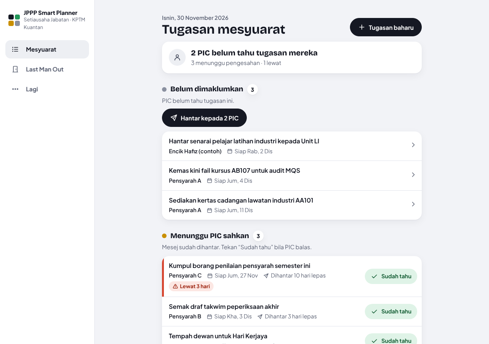

# JPPP Smart Planner

*Planner berasaskan Matriks Eisenhower (sebelum ini dikenali sebagai Eisenhower Planner).*

**Bukan sekadar senarai, tetapi jurulatih keputusan.**
*Not just a list, a decision coach.*

**Live app:** https://hafizi-ui.github.io/planner/
**Demo with a sample week:** https://hafizi-ui.github.io/planner/?demo=1



## The problem

Students and lecturers spend their week firefighting: assignments due tomorrow, last-minute forms, meetings called at short notice. Work that really matters, like the final-year project, research and lesson preparation, keeps getting pushed back until it becomes a crisis. Ordinary to-do lists record tasks but never question them.

## The idea

The Eisenhower Matrix sorts every task by two questions:

| | Urgent | Not urgent |
|---|---|---|
| **Important** | **Do / Buat**: finish first | **Schedule / Jadualkan**: give it a date |
| **Not important** | **Delegate / Agihkan**: name who handles it | **Delete / Buang**: let it go |

Many apps let you drag tasks into four boxes. This planner goes further. It **helps you decide which box**, then **shows you where your time actually went**.

## What makes it different

1. **Guided triage.** The urgent/important questions start unanswered, so nothing lands in the red box by default. Each question has a short definition (urgent = due within 48 hours or someone is waiting; important = moves a real goal forward). For urgent but unimportant tasks a third question asks *"Can someone else do it?"*.
2. **Deadline words are picked up automatically.** Typing *esok*, *hari ini*, *tomorrow* or *deadline* marks the task urgent and says why.
3. **Tasks move on their own.** When a scheduled task's date arrives, it moves to Do with a "From Schedule" label. This makes the cost of leaving things too late visible.
4. **Weekly Insight: "Ke mana masa saya pergi?"** For the last 7 days it shows what you finished by box, a day-by-day chart, a **Balance score** (share of finished work that was planned) compared with the week before, and plain-language coaching.
5. **Bahasa Melayu and English.** One tap switches every label, hint and insight.
6. **Private and offline.** No account and no server. Data stays on the device. It installs to a phone's home screen and works in flight mode.


## Meetings: assign a task to a PIC in one tap

After a meeting, put each action item in **Delegate**, pick the person in charge (PIC) and set a due date. The task then shows:

- **WhatsApp**: opens WhatsApp with a ready message to the PIC (task, due date and a Google Calendar link)
- **Email**: opens your email app with the subject and message filled in
- **Google Calendar**: creates the event and adds the PIC's email as a guest, so they get an invitation

A "Notified" label shows which PICs have been told.

**Send to each PIC** (button at the bottom of the Delegate box) groups every open task by person and builds **one message per PIC**, numbered and sorted by due date, with an optional heading such as *"Mesyuarat Jabatan Bil. 3/2026"*. Tick *"Only tasks not yet notified"* to send just the new items after a follow-up meeting.

**Team contacts** (⋯ menu) stores each member's name, WhatsApp number and email, so you never retype them. Add them one by one or import a CSV from Excel / Google Sheets (columns: name, WhatsApp no., email; optionally role, programme and Last Man Out rota, see below). Numbers like `012-345 6789` are converted to WhatsApp format automatically. Contacts stay on your device only and are never part of the public website.

## Task pack: Last Man Out (MQS)

A ready-made set of tasks for running a weekly **Last Man Out** duty rota under the **MARA Ecosystem Quality Standard (MQS)**. The rota and its daily checklist are evidence for MQS auditors that the office has an active system for **energy saving** (lights, fans and air-conditioning off after hours) and **office safety** (main switch off, doors and windows locked), with clear accountability for each week.

Add it from the ⋯ menu (**Tambah pakej: Last Man Out (MQS)**) or open https://hafizi-ui.github.io/planner/?pakej=lmo. The tasks are added on top of your existing ones (nothing is replaced), and adding the pack twice does not create duplicates.

| Box | Tasks |
|---|---|
| **Do** | List the officers for the weekly rota |
| **Schedule** | Prepare the weekly duty roster (date/week + officer name) · Prepare the checklist (lights off, air-conditioning off, main switch/plugs off, main door locked) · Add signature & time-out columns (daily record) · First weekly check by the centre MQS committee · File the roster & forms as MQS audit evidence |
| **Delegate** | Print & post the roster at the main exit / zone notice board · Tell every officer on the rota · Duty officer completes the checklist every day before leaving (fill in the PIC) |
| **Delete** | Relying on one person to close the office every day |

Scheduled dates are set from the day you add the pack (tomorrow, in 2 days, in a week), so the tasks move to Do on their own when the day arrives. Edit any date to match your audit timeline.

## Giliran Last Man Out (rota) & reminders

The task pack above helps you set the duty up. **Giliran Last Man Out** (first item in the ⋯ menu) then runs it week after week: it builds the rota, reminds each officer on time, and prints the MQS evidence.

**1. Import the department's members once.** In **Team contacts**, import a CSV with these columns (BM header; the English header `Name,WhatsApp no.,Email,Role,Programme,LMO rota` also works):

```
Nama,No. WhatsApp,Emel,Jawatan,Program,Giliran LMO
```

- **Jawatan** (role): `Ketua Jabatan`, `Setiausaha`, `Ketua Program` or `Pensyarah`
- **Program**: e.g. `AA101`, `AB101`, `AB107`, or blank
- **Giliran LMO** (in the rota?): `Ya` or `Tidak`. If blank, everyone with a role is in the rota except the Ketua Jabatan.
- WhatsApp number and email may be left blank at first. The planner shows **Lengkapkan kenalan** (complete contact) wherever one is missing.

Keep this file on your own computer. It must never be uploaded to this repository (see [Privacy note for staff data](#privacy-note-for-staff-data)).

**2. Build the rota.** Choose weekly (Monday to Friday, the default) or daily turns, the order (by programme, or A to Z), the start date and the duty time (default 6:00 to 6:15 pm), tick who is in the rota, and press **Jana jadual**. **Sambung satu pusingan** adds one more full cycle.

**3. Change it without anyone losing a turn.**

- **Swap:** pick another person for a turn; they swap with that person's next turn.
- **Cuti umum / tiada tugas** (public holiday, no duty): everyone after that week moves one slot later, and one turn is added at the end.
- Turns that have already been notified, or start within 2 days, are never changed by regenerating.

**4. Reminders, on time.**

| When | What | To whom |
|---|---|---|
| 2 days before the turn (a Monday turn is notified on Saturday) | Email + Google Calendar invitation (duty time every working day of the turn) | Duty officer |
| First day of the turn | WhatsApp reminder with the checklist | Duty officer |
| Every duty day, after the duty | Press **Selesai** (Done) to confirm the checklist, by the confirmation deadline (default 6:30 pm) | Duty officer |

The planner has no server, so a banner (*"Last Man Out: notis untuk ... perlu dihantar"*) tells you when a notice is due, with one-tap Email / Calendar / WhatsApp buttons. It remembers what was sent and flags late notices. To send the email and calendar invitation fully automatically, use the Google Apps Script below.

**5. Print the MQS evidence.** **Cetak jadual** prints the duty roster (week/date, officer, role/programme, signature, remarks). **Cetak senarai semak** prints a 4-week daily checklist (lights, air-conditioning, main switch/plugs, doors and windows locked, time out, signature) with a "checked by" line for the MQS committee.

## Automation with Google Apps Script

An optional script in [`automation/`](automation/) runs every morning (about 7 am Malaysia time, weekends included). Any staff member can install it in their own KPTM Google account; that person is the **admin**. Emails and invitations go out from the admin's account under the sender name **JPPP Smart Planner**.

- **2 days before each turn**, it emails the duty officer and sends a Google Calendar invitation (a daily series for a weekly turn, at the duty time, with a 30-minute pop-up reminder on the admin's copy). Replies go to the secretary (Reply-To).
- **On the first day of the turn**, it emails the **secretary (SU)** a one-tap `wa.me` link with the WhatsApp reminder already written. WhatsApp cannot be sent automatically without the paid WhatsApp Business Platform, so she only taps **Send** on her phone.
- The SU's address comes from, in order: the menu **Last Man Out › Emel Setiausaha (WhatsApp)**, the email on the rota row whose Jawatan is Setiausaha, or the admin.
- It never sends the same notice twice, catches up after a missed morning (until the turn starts), skips holiday weeks, cancels the old invitation when a turn is swapped, and stops before the daily email quota runs out. Problems (missing email, errors, quota, cancelled invitations) go to the **admin** in a short report, once per problem. If the SU installed the script herself, everything arrives in one daily summary.

**Message texts.** The WhatsApp text is the SU's own message, so it is identical to the planner's and signed "Setiausaha Jabatan JPPP, KPTM Kuantan". The script's **emails** intentionally differ from the planner's (which the SU sends herself in planner-only mode): they are signed "JPPP Smart Planner, Jabatan Pengurusan Perniagaan & Perakaunan, KPTM Kuantan" and ask officers to tell the **Setiausaha Jabatan** (not "saya") if they cannot do the duty. Calendar titles and descriptions are the same in both.

Setup: the SU exports **Eksport CSV untuk Google Sheet** from her planner; the admin imports it into a private Google Sheet tab named `Giliran` (or shares the Sheet with the SU so she can import it), pastes [`LastManOut.gs`](automation/LastManOut.gs) into **Extensions › Apps Script**, then chooses **Last Man Out › Pasang (sekali sahaja)**. Step-by-step guide in Bahasa Melayu: **[automation/PANDUAN.md](automation/PANDUAN.md)**. Afterwards, the SU ticks **Emel & kalendar dihantar automatik oleh Google Apps Script** in her planner so the banner only asks for WhatsApp.

Rota CSV columns (planner export → Sheet):

```
ID,Mula,Tamat,Masa mula,Masa tamat,Nama,Emel,No WhatsApp,Jawatan,Program,Cuti,Emel dihantar,Kalendar dihantar,WhatsApp dihantar,Had pengesahan,Kod pengesahan,Emel KJ,Hari tiada tugas
```

- `Had pengesahan`: confirmation deadline, `HH:mm`, not before `Masa tamat` or 17:15 (default 18:30)
- `Kod pengesahan`: the turn's secret code, `[A-Za-z0-9_-]{16,64}`; it changes whenever the person on the turn changes
- `Emel KJ`: the Ketua Jabatan's email (the planner contact whose role is Ketua Jabatan), same on every row
- `Hari tiada tugas`: no-duty days inside the turn, ISO dates separated by `;` (e.g. `2026-12-09;2026-12-10`)

The script finds columns by name (any order), still reads the older 14-column file, and may add `ID acara`, `Catatan skrip` and `Kod pengesahan` on the right. Tests (Node 18+, no install): `node --test automation/test`.

### Done confirmation ("Selesai") and escalation to the Ketua Jabatan

The owner's MQS requirement: after the duty, the officer confirms the checklist; if they do not, the Ketua Jabatan (head of department) is told.

- **Personal link.** With the script deployed as a web app (Execute as: Me; Who has access: Anyone), every WhatsApp message, D−2 email and calendar invitation carries the officer's own link, `{web app URL}?t={ID}&k={code}`. The page (Bahasa Melayu, phone-first, accessible) shows the five checklist items; **Selesai / Done** is enabled once all five are ticked, from 12:00 on the duty day. Opening a link never records anything; only the button does, and pressing it twice changes nothing. A wrong or outdated code shows "Pautan ini tidak sah" without any name.
- **Timing (defaults).** 6:15 pm: reminder email to the officer if not yet confirmed. 6:30 pm (the deadline): alert email to the Ketua Jabatan with the secretary and the admin in cc. A confirmation after the deadline is recorded as *Lewat* (late) and the Ketua Jabatan gets one follow-up email. A trigger checks every 10 minutes from 5 pm on weekdays; if all of an evening's checks failed, the next morning's run sends the alert once, marked "(semalam)".
- **No false alarms** for public holidays, no-duty days inside a weekly turn (`Hari tiada tugas`), weekends, or turns that began before the web app was set up.
- **MQS evidence.** Each day is recorded in the Sheet tab **Pengesahan**: date, turn, officer, time confirmed, status (*Tepat masa*, *Lewat*, *Tidak disahkan*, *Tiada tugas*), checklist, reminder, alert and follow-up times.
- **Without the web app**, the messages instead ask the officer to tell the secretary "SELESAI" by WhatsApp or email, and the planner shows a banner after the deadline with one-tap WhatsApp / email buttons to inform the Ketua Jabatan.
- **Ketua Jabatan email**, in order: the menu **Last Man Out › Emel Ketua Jabatan** (e.g. an acting KJ), else the `Emel KJ` column, else the alert goes to the secretary (admin in cc) with a note explaining why.
- **Security.** Codes are random (about 122 to 128 bits). Because "Anyone" can call the script's public functions from the page, the menu functions do nothing outside the Sheet, and only `confirmLmo` records a confirmation.

Setup steps in Bahasa Melayu: [PANDUAN.md section 11](automation/PANDUAN.md#11-butang-selesai-pengesahan-selepas-tugas).

## Project monitor (Pantauan projek)

For whoever follows up on delegated work, such as a head of department or project lead:

- **Status on every delegated task:** Not started / In progress / Needs help / Done, plus a short status note and "last updated" date
- **Reminder banner:** when you open the planner, it tells you how many delegated tasks are due tomorrow or overdue
- **Needs a reminder:** each such task has a one-tap **WhatsApp reminder** (or email) with a polite, ready-written message. A "Reminded today" label prevents double reminders
- **By PIC:** a card per person with a progress bar, overdue and "needs help" flags, and an **Ask for status** button. It sends one message listing that person's open tasks, with reply codes (A = Not started, B = In progress, C = Done, D = Need help), so you can update the status in seconds
- **Summary tiles:** open tasks, % done, overdue, due today/tomorrow, and tasks with no news for 5+ days

The planner has no server, so it cannot send WhatsApp messages on its own. It does the remembering for you and prepares every message, and you tap Send. Google Calendar invitations give PICs their own reminders, based on their calendar notification settings.

## How it works with Google Calendar

Google Calendar answers *when* you are busy. This planner answers *whether that busyness is worth it*. They work together: decide priorities here, then send dated Schedule tasks to Google Calendar with one tap to get reminders and sync across devices. No login or server is needed in the planner for this.

## Who it is for

Diploma and degree students juggling coursework, co-curricular work and part-time jobs, and lecturers balancing teaching, research and administration, starting at KPTM.

It is also set up for the **department secretary (Setiausaha Jabatan, SU) of JPPP** (Jabatan Pengurusan Perniagaan & Perakaunan), KPTM Kuantan: sorting department work, delegating meeting actions to PICs and following them up, and running the weekly Last Man Out (MQS) rota with its reminders.

## Features

- Add a task and answer two quick questions; the "Goes to" preview shows the box before you add it
- Move tasks by dragging, or with the Move menu (works with a keyboard and on phones)
- Dates for Schedule tasks and due dates for Delegate tasks (overdue dates are flagged)
- **Google Calendar button** on dated Schedule and Delegate tasks: opens Google Calendar with the event already filled in, so the planner decides *what* matters and Calendar handles *when* and reminders
- Double-click or use the pencil to edit; undo after deleting
- Finished and let-go tasks are kept for the weekly Insight (up to 120 days)
- Progress bar (the Delete box is not counted)
- Light and dark theme, BM/EN switch
- Export and import backups (JSON)
- Load a sample week from the ⋯ menu, or open the app with `?demo=1`
- Last Man Out duty rota with timed reminders and a printable roster and checklist (see above)
- Press `/` to jump to the task box

## Accessibility

- Every action works with a keyboard; focus stays in place after changes
- Moves and additions are announced to screen readers
- Colour contrast meets WCAG 2.2 AA in light and dark themes (checked with axe-core: 0 violations)
- Respects "reduce motion" settings

## Privacy

Everything, including team contacts and the rota, is stored in the browser's `localStorage` on your own device. The planner sends nothing to any server and there is no tracking. Use **Export backup** to move tasks to another device. The optional Apps Script runs in your own Google account, not on this website.

## Privacy note for staff data

This repository and website are **public**. Staff names, phone numbers and emails must never be committed here.

- The members CSV and the rota CSV are kept only on the secretary's device and in the private Google Sheet of the staff member who runs the script. `.gitignore` blocks the usual file names (`*ahli*.csv`, `giliran-lmo-*.csv`, `contacts-*.csv`), but always check before uploading files to GitHub.
- Examples and tests in this repository use made-up names (`Pensyarah Ujian 1`), `example.com` emails and `6012000000x` numbers only.
- Under the PDPA, it is good practice to tell staff that their work email and WhatsApp number are used for duty reminders, and to share the Sheet with no one who does not need it.

## Tech

Plain HTML, CSS and JavaScript. No frameworks, no build step, no external requests.

```
index.html             page structure
style.css              design and layout
app.js                 all app logic
sw.js                  offline support
manifest.json          install as an app
icon*.svg, icon*.png   app icons
fonts/                 self-hosted fonts (SIL Open Font License)
docs/                  screenshots
og.png                 preview image for social media links
automation/            optional Google Apps Script for Last Man Out reminders
  LastManOut.gs        the script (paste into Extensions › Apps Script)
  appsscript.json      script settings (time zone Asia/Kuala_Lumpur, V8, web app access)
  PANDUAN.md           setup guide in Bahasa Melayu
  test/                Node tests with Apps Script mocks
.gitignore             keeps staff CSV files out of the repository
```

## Publish on GitHub Pages

1. Upload **all** the files and folders above to the repository (Add file → Upload files, drag the whole folder).
2. Go to **Settings → Pages**. Set Source to **Deploy from a branch**, Branch to **main**, folder **/ (root)**, and Save.
3. After a minute the site is live at `https://YOUR-USERNAME.github.io/REPO-NAME/`.
4. When you upload new versions later, change `CACHE` in `sw.js` (for example `planner-v3`) so installed phones pick up the update.

## Run locally

Open `index.html` in a browser. Offline/install features need a web server, for example `python -m http.server`, then open `http://localhost:8000`.

Test the Apps Script without a Google account: `node --test automation/test`.

## Roadmap

- Focus mode: one Do task at a time with a 25-minute timer
- Class view for lecturers: an anonymous summary of how a class spends its week
- Reminders for Schedule dates

## Credits

Built by Ahmad Hafizi Bin Ahmad Giran, Kolej Poly-Tech MARA Kuantan.

## License

MIT. See [LICENSE](LICENSE). Fonts: Bricolage Grotesque and Plus Jakarta Sans, SIL Open Font License.
